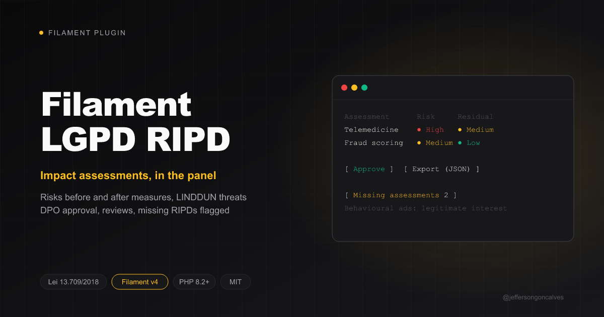

<div class="filament-hidden">



</div>

# Filament LGPD RIPD

[](https://packagist.org/packages/jeffersongoncalves/filament-lgpd-ripd)
[](https://github.com/jeffersongoncalves/filament-lgpd-ripd/actions?query=workflow%3Atests+branch%3A3.x)
[](https://github.com/jeffersongoncalves/filament-lgpd-ripd/actions?query=workflow%3A"Fix+PHP+code+styling"+branch%3A3.x)
[](https://packagist.org/packages/jeffersongoncalves/filament-lgpd-ripd)
[](LICENSE.md)

Write the data protection impact assessments (RIPD, LGPD art. 38) of [laravel-lgpd-ripd](https://github.com/jeffersongoncalves/laravel-lgpd-ripd) in your Filament panel.

## Features

- Assessments linked to a processing activity from [laravel-lgpd-records](https://github.com/jeffersongoncalves/laravel-lgpd-records), with the description of the processing, its necessity and proportionality, and the DPO's opinion.
- Risks in a repeater. Each one has an optional LINDDUN threat, a likelihood and an impact from 1 to 3, the measures taken, and the scores after those measures.
- The table shows the highest inherent risk and the highest residual risk (low, medium or high), the status and the next review.
- **Approve:** asks for the approver's name and schedules the next review. Editing an approved assessment sends it back to draft.
- **Missing assessments:** lists the processing activities that have sensitive data or rely on legitimate interest but have no assessment yet.
- **Export (JSON)** for each assessment.
- 19 languages.

## Compatibility

| Plugin Version                                                           | Filament |
|--------------------------------------------------------------------------|----------|
| [1.x](https://github.com/jeffersongoncalves/filament-lgpd-ripd/tree/1.x) | 3.x      |
| [2.x](https://github.com/jeffersongoncalves/filament-lgpd-ripd/tree/2.x) | 4.x      |
| [3.x](https://github.com/jeffersongoncalves/filament-lgpd-ripd/tree/3.x) | 5.x      |

## Installation

You can install the package via composer:

```bash
composer require jeffersongoncalves/filament-lgpd-ripd:"^3.0"
php artisan vendor:publish --tag="lgpd-records-migrations"   # if not published yet
php artisan vendor:publish --tag="lgpd-ripd-migrations"
php artisan migrate
```

## Usage

```php
use JeffersonGoncalves\Filament\LgpdRipd\LgpdRipdPlugin;

public function panel(Panel $panel): Panel
{
    return $panel
        ->plugins([
            LgpdRipdPlugin::make()
                ->navigationGroup('LGPD')             // default: no group
                ->navigationSort(7)
                ->navigationIcon('heroicon-o-shield-exclamation')
                ->slug('impact-assessments'),
        ]);
}
```

All fluent methods are optional. Pair it with [filament-lgpd-records](https://github.com/jeffersongoncalves/filament-lgpd-records) to maintain the processing activities in the same panel.

> The resource has no authorization of its own: register it only on panels whose users write the assessments, or add a policy for `JeffersonGoncalves\LgpdRipd\Models\ImpactAssessment`.

## Testing

```bash
composer test
```

## Changelog

Please see [CHANGELOG](CHANGELOG.md) for more information on what has changed recently.

## Contributing

Please see [CONTRIBUTING](.github/CONTRIBUTING.md) for details.

## Security Vulnerabilities

Please review [our security policy](../../security/policy) on how to report security vulnerabilities.

## Credits

- [Jefferson Gonçalves](https://github.com/jeffersongoncalves)
- [All Contributors](../../contributors)

## License

The MIT License (MIT). Please see [License File](LICENSE.md) for more information.
